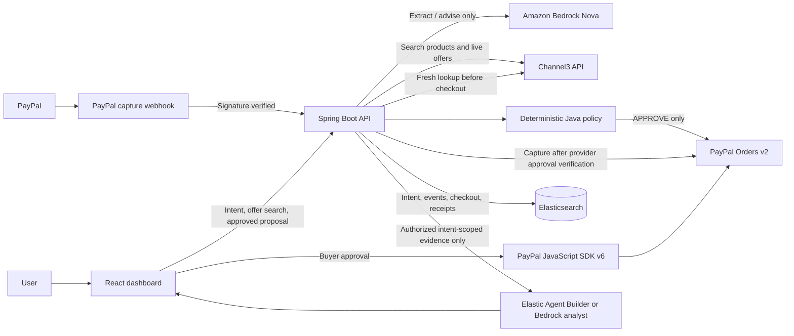

# IntentOS Architecture

## Trust Boundaries

- Channel3 is product/offer discovery. Offer price, stock, merchant, category, attributes, and retrieval time are evidence, not authorization. The backend refreshes a selected offer before checkout.
- Java policy validation is authoritative for `APPROVE`, `MODIFY`, `HOLD`, and `BLOCK`, and computes the payable amount. Missing or negative tax/shipping blocks approval.
- PayPal Orders v2 is called only after deterministic approval. The buyer approves using PayPal JS SDK v6; the backend independently verifies the PayPal order before server-side capture.
- The webhook is signature-verified with PayPal before it can update capture state or finalize an AgentReceipt.
- A PayPal Sandbox capture pays the configured Sandbox merchant. It is not evidence that a Channel3 retailer received funds or fulfilled the offer.
- Receipt search and analyst calls are scoped by backend intent access control. Only retrieved receipts for the authorized intent and server-calculated metrics enter the analyst prompt. The analyst has no authority to alter policy or payment state.
- Provider keys remain in backend environment/SSM SecureString. The browser receives only the public PayPal client ID and boolean readiness flags.
