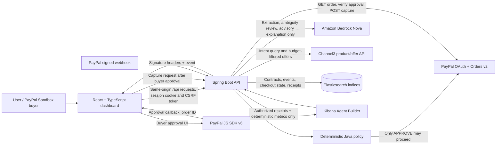
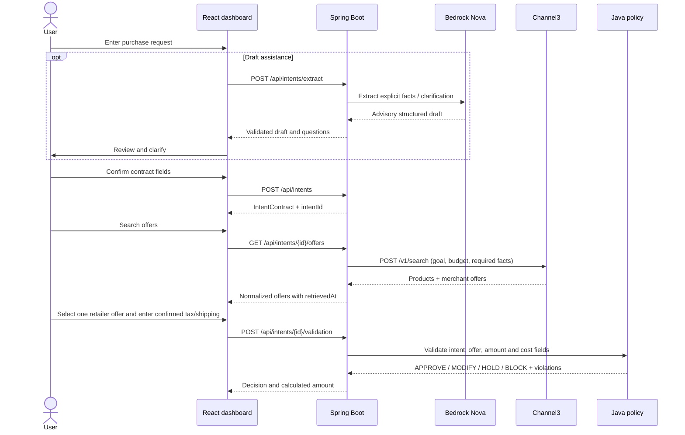
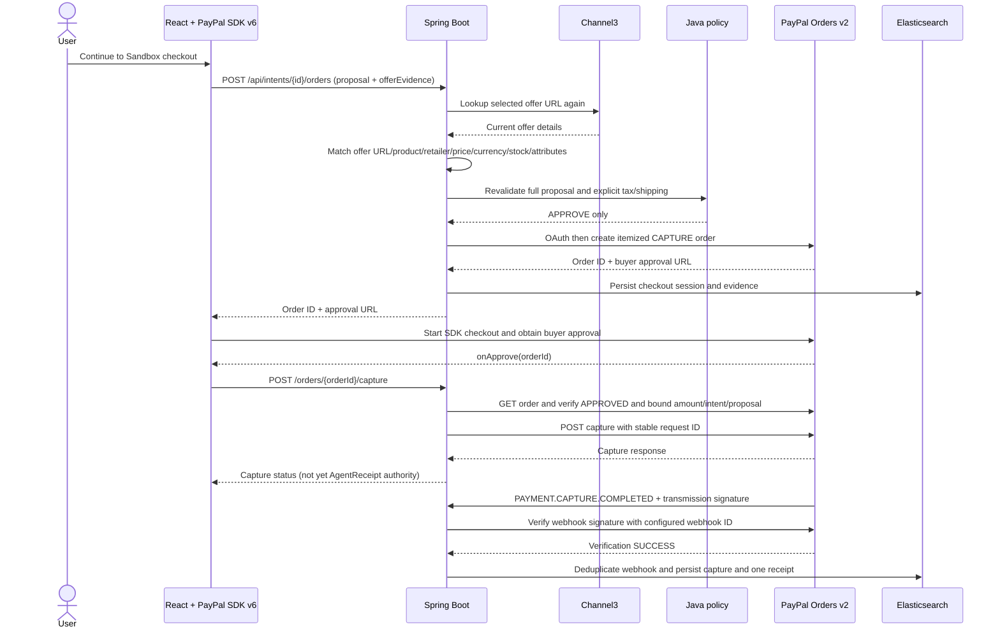
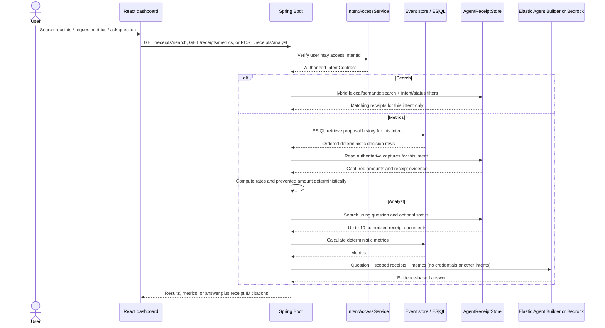

# IntentOS Architecture

IntentOS is a Spring Boot modular monolith and React single-page application. The browser gathers user intent, presents product offers, and hosts PayPal buyer approval. The backend owns authorization, policy evaluation, provider credentials, order creation/capture, webhook verification, persistence, receipt search, and analyst evidence scoping.

## System Context

## Backend Modules

| Module | Responsibility | Important routes/data |
| --- | --- | --- |
| `auth` | PayPal Login, session identity, CSRF enforcement | `/api/auth/session`, `/api/auth/paypal`, `/api/auth/logout` |
| `intent` | Intent contracts, extraction, decision history, model interface | `/api/intents`, `/api/intents/extract`, `/api/intents/{id}/events` |
| `paypal` | Channel3 offers, PayPal Catalog metadata, Orders/capture, checkout state, webhook verification, AgentReceipts and receipt intelligence | `/api/intents/{id}/offers`, `/api/intents/{id}/orders`, `/api/webhooks/paypal`, `/api/intents/{id}/receipts/**` |
| `validation` | Deterministic policy decisions and total calculation | `/api/intents/{id}/validation` |
| `repair` | Bounded deterministic proposal repair and repair history | `/api/intents/{id}/repair` |
| `health` | Health and non-secret integration readiness | `/api/health`, `/api/integrations/status` |

The model client is advisory. It may extract intent or write evidence-grounded explanations, but cannot approve, price, create/capture PayPal payments, process webhooks, or change receipts.

## Browser Flow

1. **Overview / sign-in:** The UI checks `/api/health`, `/api/integrations/status`, and `/api/auth/session`. With auth required, intent routes use the PayPal session cookie and unsafe requests include the session CSRF token.
2. **Intent contract:** The user types a request. “Draft from request” calls `/api/intents/extract`; extracted fields and clarification questions are reviewed before `POST /api/intents` creates the contract. Intent creation resets the active offers, decisions, receipts, and metrics to that intent.
3. **Retailer offers:** “Search offers” calls `GET /api/intents/{intentId}/offers`. Results show product, retailer, live price/currency, availability, attributes, offer URL, and retrieval time. The user explicitly selects an offer.
4. **Cost confirmation and policy:** The user supplies confirmed tax and shipping values, including explicit zero only when verified. “Validate selected offer” submits a proposal to the Java validator. Missing/negative costs or any policy violation prevent checkout.
5. **Payment:** Only an `APPROVE` result enables PayPal SDK v6 checkout. The backend refreshes the Channel3 URL and checks product, retailer, price, currency, stock, category, and attributes before creating a PayPal Sandbox order. The SDK obtains buyer approval. Its approval callback sends the order ID to the backend capture route; the browser never captures funds.
6. **Activity and receipt:** The timeline shows validation/order/capture evidence. Only a signature-verified `PAYMENT.CAPTURE.COMPLETED` webhook finalizes an AgentReceipt. The receipt view supports query/status filters and the question form.
7. **Receipt intelligence:** The dashboard reads deterministic metrics from `/receipts/metrics`, searches through `/receipts/search`, and sends a question to `/receipts/analyst`. Responses identify which receipt IDs were retrieved.

The **sample proposal repair** action is currently a separate hard-coded demonstration proposal; it is not connected to the selected Channel3 offer or the later receipt’s proposal lineage. Do not present it as an actual repair of the purchased offer. Connecting repair history to offer-backed carts is a remaining product improvement.

## Intent and Offer Sequence

## PayPal Checkout and Receipt Sequence

A Sandbox capture is a payment to the configured PayPal Sandbox merchant. It does **not** prove the Channel3 retailer was paid or fulfilled an order. The UI and demo must preserve that distinction.

## Receipt Search, Metrics, and Analyst Sequence

Metrics are calculated by Java, not by an LLM. The current denominator is the set of distinct proposal IDs with decision events for the active intent. Semantic matching is used only when the configured Elasticsearch deployment supports a `semantic_text` receipt field; otherwise the same API uses lexical retrieval.

## Persistence

| Index / store | Contents | Write authority |
| --- | --- | --- |
| `intent-v1` | Intent contracts | Intent API |
| `intent-event-v1` | Append-only validation, repair, order, capture and webhook timeline events | Backend event writers |
| `paypal-checkout-v1` | Offer-backed proposal snapshot, approved amount/currency, capture state | Checkout and verified webhook handlers |
| `paypal-webhook-v1` | Processed PayPal webhook event IDs | Verified webhook handler |
| `agent-receipt-v1` | One immutable AgentReceipt per captured PayPal order, including `preventedAmount` and `searchText` | Verified completed-capture webhook only |

When Elastic is disabled, the local in-memory adapters support development/tests but do not survive backend restarts.

## External Setup Still Required

- Elastic Agent Builder agent/tools must be provisioned in the target Kibana space using `node scripts/provision-elastic-agent-builder.mjs` and a short-lived management key.
- Runtime Agent Builder chat requires `ELASTIC_KIBANA_URL`, a separate read-only `ELASTIC_AGENT_BUILDER_API_KEY`, and the `receipt-analyst` agent ID.
- Semantic ranking requires an Elasticsearch inference endpoint and `agent-receipt-v1.searchText` mapped as `semantic_text`. Otherwise lexical fallback remains active.
- A clean deployed PayPal Sandbox → verified webhook → searchable receipt walkthrough and the under-three-minute demo recording remain release checks.
