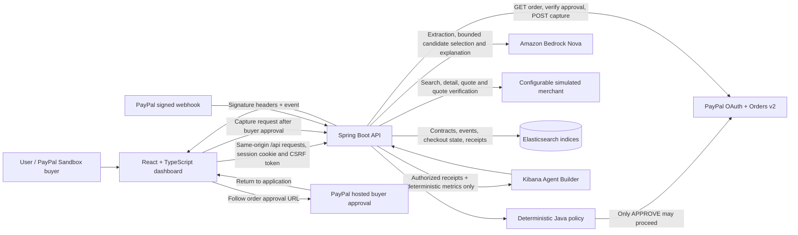
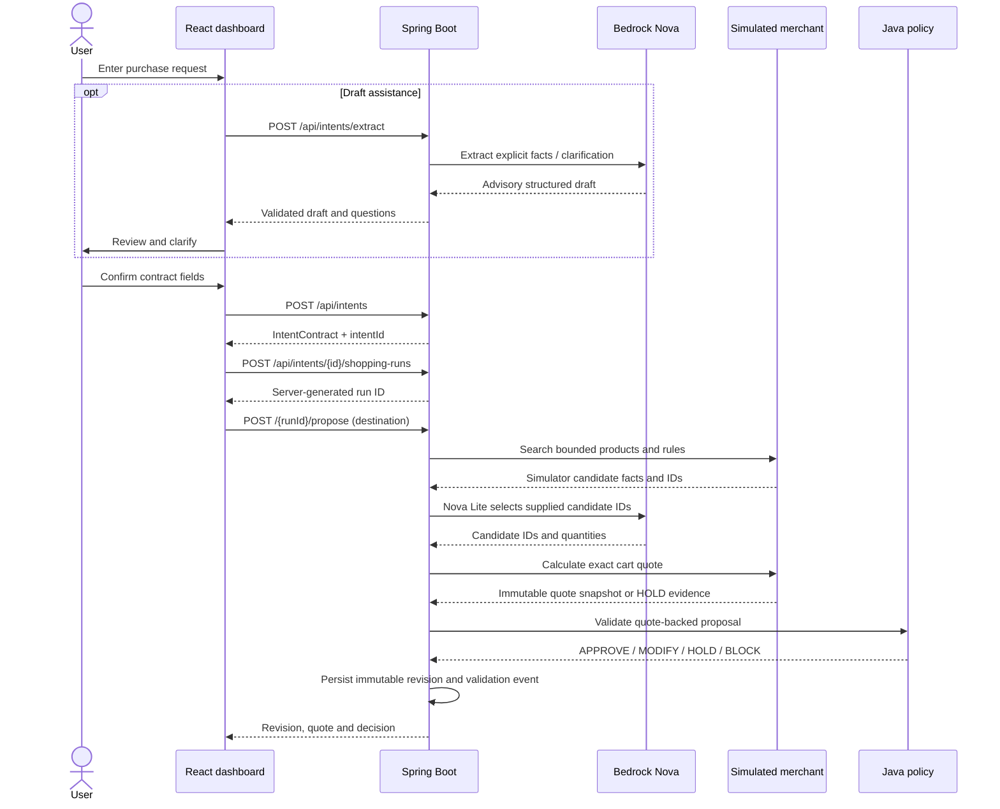
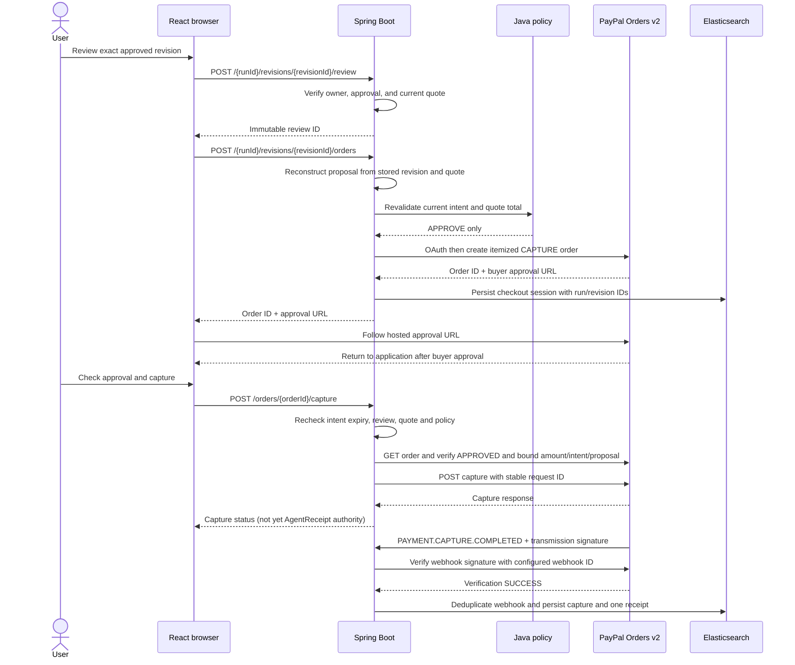
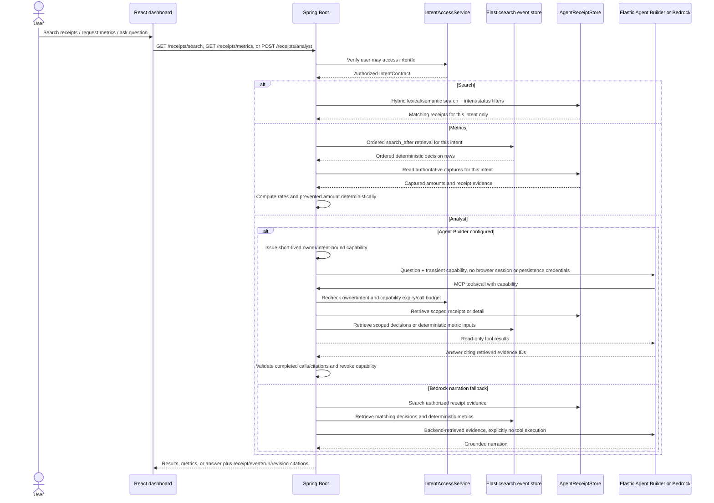

# IntentOS Architecture

IntentOS is a Spring Boot modular monolith and React single-page application. The browser gathers intent and destination, shows the Nova-proposed simulator cart/quote, records final review, and hosts PayPal buyer approval. The backend owns authorization, policy evaluation, quote calculation, order creation/capture, webhook verification, persistence, history and analyst evidence scoping.

## System Context

## Backend Modules

| Module | Responsibility | Important routes/data |
| --- | --- | --- |
| `auth` | PayPal Login, session identity, CSRF enforcement | `/api/auth/session`, `/api/auth/paypal`, `/api/auth/logout` |
| `intent` | Intent contracts, extraction, decision history, model interface | `/api/intents`, `/api/intents/extract`, `/api/intents/{id}/events` |
| `merchant` | Configurable simulated catalog, calculated quotes and freshness checks | `/api/intents/{id}/merchant/**` |
| `shopping` | Server-owned runs, immutable quote-backed revisions, repair, review, history and simulator checkout | `/api/intents/{id}/shopping-runs/**`, `/api/shopping-history` |
| `paypal` | Orders/capture, checkout state, webhook verification, AgentReceipts and receipt intelligence | `/api/intents/{id}/orders/{orderId}/capture`, `/api/webhooks/paypal`, `/api/intents/{id}/receipts/**` |
| `validation` | Deterministic policy decisions and total calculation | `/api/intents/{id}/validation` |
| `repair` | Bounded deterministic proposal repair and repair history | `/api/intents/{id}/repair` |
| `health` | Health and non-secret integration readiness | `/api/health`, `/api/integrations/status` |

The model client is advisory. It may extract intent or write evidence-grounded explanations, but cannot approve, price, create/capture PayPal payments, process webhooks, or change receipts.

## Browser Flow

1. **Overview / sign-in:** The UI checks `/api/health`, `/api/integrations/status`, and `/api/auth/session`. With auth required, intent routes use the PayPal session cookie and unsafe requests include the session CSRF token.

2. **Intent contract:** The user types a request. Nova extraction/clarification is reviewed before `POST /api/intents` creates the contract.

3. **Shopping run:** The user enters country, region, and shipping method. `POST /api/intents/{id}/shopping-runs/{runId}/propose` supplies up to 50 simulator candidates to Nova Lite, validates the returned candidate IDs, creates a computed quote, validates it in Java, and persists a revision.

4. **Repair and review:** A non-approved proposal may use deterministic repair within the same run. A repaired cart receives a new quote/revision. Only an `APPROVE` revision can be reviewed, and the review binds to its exact revision and quote.

5. **Payment:** The backend reconstructs order facts from the persisted revision/quote, checks review and current policy, then creates a PayPal Sandbox order. The buyer follows the PayPal hosted approval URL and returns to the application, then chooses **Check approval and capture**. The server verifies buyer approval; URL parameters are not payment evidence. Immediately before capture, the backend rechecks expiry, current quote and policy; the browser never captures funds directly.

6. **Activity and receipt:** Only a signature-verified `PAYMENT.CAPTURE.COMPLETED` webhook finalizes an AgentReceipt. Receipt events are scoped to the captured run (legacy records remain proposal-scoped).

7. **History and intelligence:** Authenticated users can search shopping runs across owned intents, including unpaid decisions. After intent authorization, the analyst issues a short-lived capability and Agent Builder invokes four read-only backend MCP tools for receipts, decisions, detail, and deterministic metrics. Completed calls and retrieved evidence citations accompany tool-backed answers. Without Agent Builder configuration, Bedrock narration remains explicitly labeled. Deployment requires importing/attaching the remote MCP tools; see the integration guide.

With Elastic enabled, quote snapshots persist in `merchant-quote-v1`. Otherwise they use local server-owned files; that directory needs a durable mount across container replacement. Other in-memory payment adapters remain non-durable when Elastic is disabled. The simulator does not reserve inventory or place a physical order.

## Shopping and Quote Sequence

## PayPal Checkout and Receipt Sequence

A Sandbox capture is a payment to the configured PayPal Sandbox merchant. It does **not** place a physical order or prove retailer settlement. The UI and example must preserve that distinction.

## Receipt Search, Metrics, and Analyst Sequence

Metrics are calculated by Java, not by an LLM. New events are grouped by logical shopping run; legacy events without run IDs are grouped by proposal ID. Final compliance requires APPROVE with no violations on the final validated revision. First-pass compliance is reported separately. Prevented amount includes only a same-run original-to-final-approved delta; unresolved BLOCK/HOLD is reported as blocked exposure, not savings. Current Elastic retrieval caps and semantic mode still require explicit completion before release.

## Persistence

| Index / store | Contents | Write authority |
| --- | --- | --- |
| `intent-v1` | Intent contracts | Intent API |
| `intent-event-v1` | Append-only validation, repair, order, capture and webhook timeline events | Backend event writers |
| `merchant-quote-v1` | Immutable simulator quote snapshots | Merchant quote service |
| `shopping-run-v1`, `shopping-revision-v1`, `shopping-review-v1` | Shopping run, immutable cart revisions, owner-bound final review | Shopping API |
| `paypal-checkout-v1` | Simulator quote-backed proposal, approved amount/currency, capture state and lineage IDs | Checkout and verified webhook handlers |
| `paypal-webhook-v1` | Processed PayPal webhook event IDs | Verified webhook handler |
| `agent-receipt-v1` | One immutable AgentReceipt per captured PayPal order, including `preventedAmount` and `searchText` | Verified completed-capture webhook only |

When Elastic is disabled, the local in-memory adapters support development/tests but do not survive backend restarts.

## External Setup Still Required

- Import the four remote tools from the IntentOS MCP connector, then attach them in the target Kibana space using `INTENTOS_MCP_TOOL_IDS` and `node scripts/provision-elastic-agent-builder.mjs` with a short-lived management key. Raw ES|QL tools must not be attached to this user-facing agent.

- Runtime Agent Builder chat requires `ELASTIC_KIBANA_URL`, a least-privilege `ELASTIC_AGENT_BUILDER_API_KEY` without broad Elasticsearch access, the `receipt-analyst` agent ID, and an MCP connector to `/api/analyst/mcp` with four imported tools attached. Capabilities live in one backend process for two minutes and are revoked when narration ends. Live tool/citation acceptance remains open.

- Semantic ranking requires an Elasticsearch inference endpoint and `agent-receipt-v1.searchText` mapped as `semantic_text`. Otherwise lexical fallback remains active.

- A clean deployed PayPal Sandbox → verified webhook → searchable receipt walkthrough and the under-three-minute example recording remain release checks.
